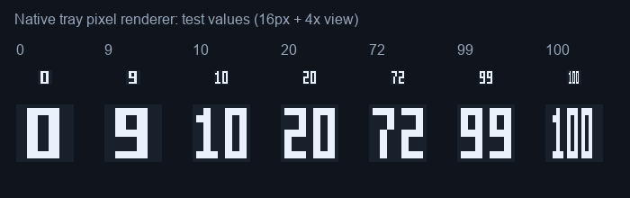

# Mouse Battery Tray · 鼠标电量托盘

适用于 **Windows 10 / 11** 的鼠标电量监控工具，面向 **Ninjutso Sora V2** 与 **ATK X1 Pro Max**。原生 C# / Windows Forms 实现，无需安装 Python。

## 下载与运行

前往 [Releases](https://github.com/ydc156439/mouse-battery-tray/releases/latest) 下载 ZIP，解压到固定位置，双击带版本号的 EXE（例如 `MouseBatteryTray-v1.2.2-Windows.exe`）。首次运行会打开电量面板，仅在检测到已连接设备时显示对应卡片与托盘图标。

- 托盘图标直接显示电量数字，悬停查看设备名称和充电状态。
- 仅展示已检测到的连接设备，未插入或拔出后隐藏对应卡片和图标。
- 每 2 秒检查设备插拔，新插入设备立即查询；正常电量查询仍按设置间隔执行。
- 深色设备面板、大号电量、充电状态及进度显示。
- 默认每 60 秒查询；可调整为 30 秒、1 分钟、2 分钟或 5 分钟。
- 低电量提醒、阈值设置和开机启动，均可在面板调整。
- 关闭面板后继续在托盘运行；双击托盘图标或再次启动 EXE 打开面板。
- 开机启动保持后台；完全退出可使用面板「退出」或托盘右键菜单。
- 无设备时没有设备托盘图标，可再次双击 EXE 打开面板。
- 托盘数字根据系统任务栏深浅主题调整颜色。
- 支持本机诊断导出；不会自动上传设备数据。

连接状态按 USB 接收器/有线设备的 HID 枚举结果判断。接收器已插入但鼠标休眠时，保留设备并说明状态。

已连接但未获得有效读数时显示 `--`，并说明离线、休眠或读取失败。不会用历史读数伪装当前电量。

## v1.2.1 数字显示修复

修复两位数只显示十位、个位被裁切的问题。托盘改用固定 16×16 像素数字网格，确保 0–100 完整显示，不依赖字体换行或留白。

以下为实际数字绘制器输出的测试值，包含 16px 原尺寸和 4 倍放大；并非 Windows 桌面截图：



## 版本识别

从 v1.2.2 起，发布的 EXE 和 ZIP 均在文件名中包含版本号，例如 `MouseBatteryTray-v1.2.2-Windows.exe` 和 `MouseBatteryTray-v1.2.2-Windows.zip`。主窗口标题、说明文件、Windows 文件属性及诊断文件也包含版本号。源码构建输出仍为 `release/MouseBatteryTray.exe`。

## 系统要求

标准 Windows 10 / 11 桌面环境，.NET Framework 4.6 或更高版本（Windows 10/11 自带）。EXE 为 AnyCPU 托管程序，不依赖 Python、第三方 HID DLL 或另行安装的 .NET 8。

此 EXE 不能直接运行于 macOS、Linux 或手机系统。精简系统、Windows S 模式及受组织策略限制的电脑可能无法运行。

## 设备与协议

| 设备 | VID / PID | HID 接口 |
| --- | --- | --- |
| Sora V2 | `1915:AE1C` 无线 / `1915:AE11` 有线 | Usage Page `FFA0`，Feature Report 5 |
| ATK X1 Pro Max | `373B:1017`，以及已列入白名单的 ATK 接收器 | Usage Page `FF02` / `FF04`，Output Report 8 |

ATK 接收器 PID 白名单：`101A`、`101B`、`1031`、`1159`、`11A7`、`1283`、`11D9`、`1278`、`11FE`、`127A`、`11FD`、`1279`。通用接收器无法证明所连接的鼠标型号，本工具按目标设备命名。

当前假定每个品牌只有一只目标鼠标；多个同品牌设备时取第一个有效读数。不同固件和接收器变体可能需要额外适配，新 `FF05` 协议与蓝牙模式尚未适配。程序仅查询电量，不改写 DPI、配对、配置或固件。

## 故障排查

1. 移动或点击鼠标唤醒，再点击「立即刷新」。
2. 关闭官方驱动、ATK HUB 和 Ninjutso 网页驱动，避免同时占用 HID 接口。
3. 重新插拔接收器，或只连接一款设备排查。
4. 在「连接排查」中导出诊断。

设置、日志和诊断保存在 `%LOCALAPPDATA%\MouseBatteryTrayNative`。诊断不包含设备序列号和完整系统设备路径。卸载前先取消开机启动、退出程序，再删除程序文件夹和本机设置目录。

## 从源码构建

在 Windows 双击 `native/build.bat`，使用系统 .NET Framework 编译器生成 `release/MouseBatteryTray.exe`，无需 Python 或 NuGet 依赖。源码采用 C# 5 语法。

开发者如安装 .NET 8 SDK，可运行协议测试：

```sh
dotnet run --project native/tests/ProtocolTests.csproj
```

.NET 8 只用于开发测试，使用 EXE 不需要安装。

## 实际验证状态

- 已交叉编译 Windows GUI EXE，并检查 PE / CLR 结构；C# 5 / .NET Framework 4.6 编译通过。
- 43 项协议、插拔及数字绘制测试通过，覆盖设备白名单、响应校验、异常数据、充电、离线、真实 0%、动态插入/拔出以及避免重复电量请求等情况。
- **尚未在真实 Windows 桌面及两款实物鼠标上测试**。托盘、界面布局、通知、开机启动和实际电量仍待实机验证。
- 测试使用模拟协议响应，不代表已读取实物鼠标。

下载文件附有 `SHA256.txt`，可核对 EXE 完整性。

## 协议参考

代码独立编写，设备编号与电量字段依据以下公开实现核对：

- [Sora Tray](https://github.com/Fan4Metal/Sora_tray/blob/master/sora_tray.py)
- [ATK 设备表](https://github.com/papelblume/atk-tool-plus/blob/main/registry.go)
- [ATK 电量查询](https://github.com/papelblume/atk-tool-plus/blob/main/device.go)
- [ATK 报文说明](https://github.com/666mille/MyATxMouseControl#protocol)
